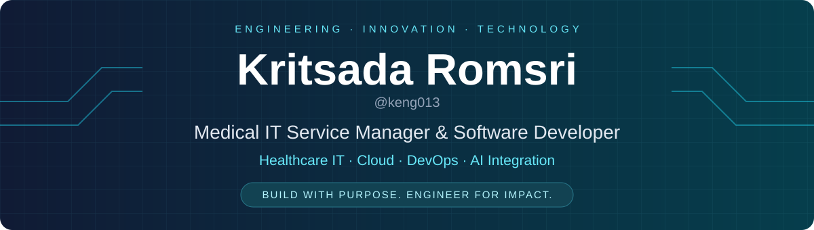

  
  
  

<strong>Medical IT Service Manager</strong> Healthcare IT · Software Developer · DevOps · Cloud · AI

## About me

I work at the intersection of healthcare technology, software engineering and enterprise infrastructure. My focus is on building secure, reliable and scalable solutions that improve operational workflows.

| Medical IT | Software Engineering |
| :--- | :--- |
| PACS, RIS, DICOM and healthcare integration | Web applications, APIs and automation |
| **Cloud & Infrastructure** | **DevOps & Security** |
| Linux, Windows Server and virtualization | CI/CD, cybersecurity and system reliability |

## Technology & tools

**Software Development**

    

**Infrastructure & DevOps**

      

**Database & Healthcare**

  

**Healthcare Interoperability & AI**

  

## Engineering focus

| Area | Focus |
| :--- | :--- |
| Healthcare solutions | Medical imaging and clinical workflows |
| Enterprise applications | Management platforms and business automation |
| Digital innovation | Intelligent applications and AI integration |
| Platform engineering | Secure infrastructure and deployment automation |

## GitHub activity

  <picture>
    <source media="(prefers-color-scheme: dark)" srcset="https://github-readme-stats.vercel.app/api?username=keng013&amp;show_icons=true&amp;theme=github_dark&amp;hide_border=true" />
    
  </picture>
  <picture>
    <source media="(prefers-color-scheme: dark)" srcset="https://github-readme-stats.vercel.app/api/top-langs/?username=keng013&amp;layout=compact&amp;theme=github_dark&amp;hide_border=true" />
    
  </picture>

<!-- GitHub's native contribution graph appears below the profile README. External cards may be unavailable or show limited public data. -->

---

<em>Build with purpose. Engineer for impact.</em>

